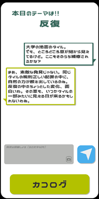
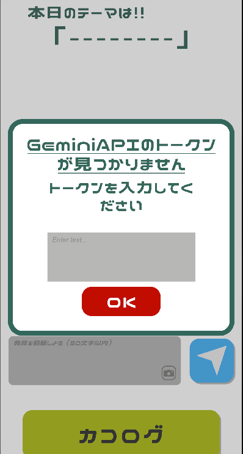

# 発見冒険ログブック

## 概要
Unityを用いて自分用に作成したアプリ。
日々、周囲のモノに意識を向ける機会を増やすべく、カラーバス効果を活用して「発見を記録する」アプリ。
カラーバス効果とは、特定のテーマに注意を向けることで周囲の関連情報に気づきやすくなる心理現象です。
このアプリには、GeminiAPIを利用しています。

- 一部の機能はまだ実装中または保留状態です。
- バグや表示の不具合が発生する可能性があります。
- 今後、機能追加や改善を予定しています。

## 由来
祖母が、私の幼いころにつけることを進めた絵日記「発見冒険ノート」がもとです。
日々の発見を絵日記として記録するものだが、当時は面倒くさくて三日坊主にしてしまいました。
しかし、大学生になり、日々の中でいろいろなモノに注意を向けることの大切とする、
祖母の思いがなんとなくわかったような気がします。
祖母の１周忌を前に、もう一度発見冒険をしてみようと思い立ち、このアプリを作ることとしました。

## 特徴
- 日々のテーマを自動で決定してくれるため、日々の発見に幅が生まれる
- 発見を書き込むと、AIが褒めたりコメントしてくれるため、継続しやすい
- 過去の履歴をさかのぼれる
- 写真を撮って記録もできる

## アピールポイント
**1. 非同期処理（async/await）を用いたAPI連携とUI制御**
 - 該当ファイル: AppManager.cs, GeminiClient.cs
 - アピール点: ネットワーク通信やAIの生成待ちが発生する処理において、Taskやasync/awaitを適切に使用し、アプリがフリーズしないスムーズなユーザー体験（UX）を実装しました。

**2. UIシステムの実装（シングルトンとポップアップ管理）**
 - 該当ファイル: PopUpWindowController.cs, PopUpWindow.cs, UIDirector.cs
 - アピール点: シングルトンパターンを用いて、アプリ内のどこからでも簡単にポップアップを表示・制御できるシステムを構築しました。コールバック関数（Action<string>）を用いることで、入力内容に応じた処理の分岐を柔軟に記述できるように設計しています。

**3. 効率的なデータ保存と履歴管理**
 - 該当ファイル: UsageHistoryManager.cs
 - アピール点: ユーザーの日々の発見（JSON形式）を日付ごとに管理し、効率的に読み書きを行うマネージャークラスを自作しました。LINQを用いて「直近のテーマの取得」や「日付順でのソート」など、データ操作を簡潔かつ高速に行えるよう実装しています。

---

## 開発環境
|項目|内容|
|------|------|
| 開発環境 | Unity 2022.3.49f1 |
| 言語 | C# |
| プラットフォーム | Android |
| 外部ライブラリ | GeminiAPI |

---

## 利用にあたって
初回利用時にGeminiAPIのアクセスキーを入力する必要があります。
個人利用として作成したため、各自でキーの取得・入力を必要とします。

APIキーは [Google Cloud Console](https://console.cloud.google.com/) から Gemini API を作成して取得します。

